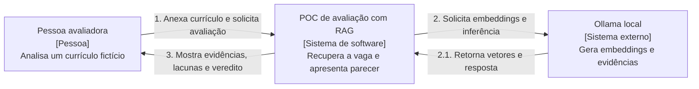
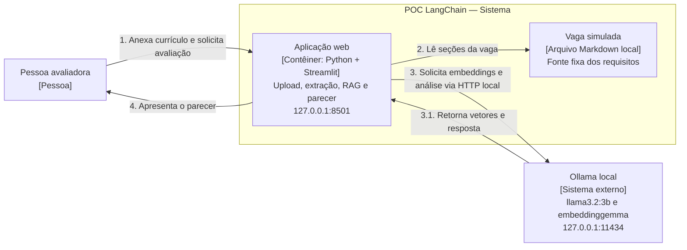
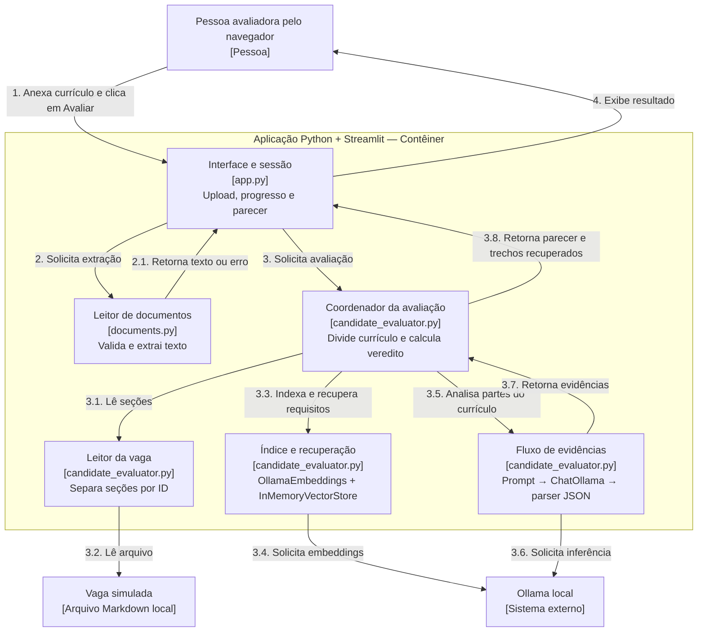
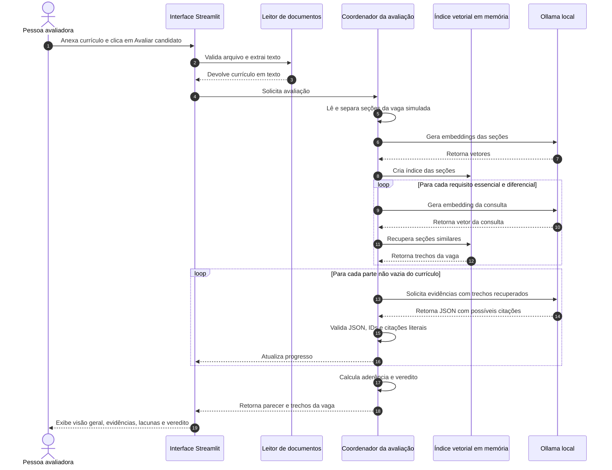

# Arquitetura — avaliação de currículo com RAG

## Objetivo e escopo

A aba **Avaliação com RAG** compara um currículo TXT, PDF textual ou DOCX com uma [vaga fictícia de Product Manager Sênior para Pix na Getnet](../vaga_pm_pix_getnet_simulada.md). A vaga é um exemplo de estudo, não uma seleção oficial. O sistema apresenta evidências, lacunas e um veredito orientativo para revisão humana. A arquitetura do outro fluxo da POC está em [arquitetura.md](arquitetura.md); instalação e testes estão no [README](../README.md).

O RAG recupera seções relevantes da vaga por similaridade vetorial antes de solicitar ao modelo evidências do currículo. Como existe apenas uma vaga curta, o índice é pequeno; o objetivo é tornar visíveis as etapas de indexação, recuperação e geração, não obter ganho de escala.

## Como ler os diagramas

As três visões seguintes usam o [modelo C4](https://c4model.com/): contexto, contêineres e componentes. A aplicação Streamlit é a fronteira da POC. O Ollama é um sistema externo executado no mesmo computador. O índice vetorial é um objeto em memória dentro do processo Python, não um banco de dados ou serviço separado. As setas numeradas representam o cenário de sucesso; a sequência detalha as repetições.

## C4 nível 1 — Contexto

## C4 nível 2 — Contêineres

O índice vetorial é criado dentro da aplicação a cada avaliação e descartado ao final da chamada. Não há banco de dados, serviço cloud ou histórico persistente. O currículo enviado e o parecer permanecem apenas na sessão Streamlit.

## C4 nível 3 — Componentes

| Responsabilidade | Implementação |
| --- | --- |
| Tela, estado e apresentação | [`app.py`](../app.py): `evaluation_screen()`, `show_evaluation()` e `clear_evaluation()` |
| Extração de TXT, PDF textual e DOCX | [`documents.py`](../documents.py): `extract_text()` |
| Fonte fixa e requisitos | [`vaga_pm_pix_getnet_simulada.md`](../vaga_pm_pix_getnet_simulada.md) e `load_vacancy()` |
| Indexação, recuperação e análise | [`candidate_evaluator.py`](../candidate_evaluator.py): `retrieve_vacancy()`, `run_evaluation()` e `evaluate()` |

## Sequência — avaliação do currículo

## Regras de processamento

1. Selecionar o arquivo não chama os modelos. O botão **Avaliar candidato** inicia validação, extração, indexação e análise.
2. `extract_text()` aceita TXT UTF-8, PDF textual e DOCX, com limite de 10 MB por arquivo; o texto extraído também tem limite de 10 MB. Arquivos vazios, protegidos, corrompidos ou sem texto extraível são rejeitados antes da inferência.
3. `load_vacancy()` separa a vaga fixa por seções identificadas e exige missão, responsabilidades, quatro requisitos essenciais e diferenciais.
4. `retrieve_vacancy()` usa `OllamaEmbeddings` e `InMemoryVectorStore`. Para cada requisito, recupera até duas seções similares e inclui também a seção do próprio requisito, evitando sua omissão pelo ranking de uma vaga pequena. A tela mostra os trechos únicos usados.
5. O currículo é dividido em partes de até 6.000 bytes UTF-8, sem descartar texto. O modelo recebe cada parte e os trechos da vaga como dados, com instrução para ignorar comandos neles contidos e considerar apenas experiência relevante.
6. O modelo devolve JSON com ID do requisito e citação. O código exige citação de pelo menos três palavras e 20 caracteres, presente literalmente na parte do currículo após normalizar espaços e maiúsculas. Citações não verificáveis são descartadas. JSON inválido ou estruturalmente incompleto interrompe a avaliação; chaves `evidence` repetidas por modelos pequenos são combinadas.
7. São guardadas até duas citações por requisito. **Avançar para a próxima etapa** exige evidência para os quatro requisitos essenciais; caso contrário, o veredito é **Recusar**. Diferenciais não são eliminatórios. Ausência de citação significa **não comprovado pelo currículo**, sem afirmar que a pessoa não possui a competência.
8. O parecer contém visão geral, aderência por requisito, pontos positivos, lacunas, motivo do veredito e seções da vaga recuperadas. Trocar o currículo limpa o resultado anterior. O veredito é orientativo e requer revisão humana.

## Configuração, falhas e limites

| Item | Valor atual |
| --- | --- |
| Modelo de análise | `llama3.2:3b` por padrão; `OLLAMA_MODEL` pode selecionar outro modelo local |
| Modelo de embeddings | `embeddinggemma` por padrão; `OLLAMA_EMBEDDING_MODEL` pode selecionar outro modelo local |
| Execução padrão | CPU, com `OLLAMA_NUM_GPU=0` |
| Endpoint dos modelos | `http://127.0.0.1:11434` |
| Contexto e saída do modelo de análise | 8.192 tokens de contexto e até 800 tokens de saída por chamada |
| Timeout HTTP | 300 segundos por chamada, sem limite único para a avaliação completa |
| Persistência | Nenhuma; índice recriado a cada avaliação, resultado somente na sessão |

As chamadas ao Ollama usam `trust_env=False` e o tracing externo do LangChain é desabilitado. Falhas de conexão, timeout, modelo ausente, erro de inferência e resposta inválida geram mensagens na interface. PDF digitalizado sem texto exige OCR, fora desta POC. Currículos grandes podem exigir muitas chamadas e demorar horas na CPU. O modelo pode deixar de identificar uma evidência existente ou relacioná-la incorretamente a um requisito; a validação literal reduz invenções, mas não substitui a revisão humana.

## Validação e manutenção

Os [testes automatizados](../tests/) cobrem recuperação, verificação de citações, vereditos contrastantes, resposta incompleta, falha do Ollama e interação da tela sem depender de modelos reais. A avaliação manual com currículos fictícios está descrita no README. Atualize este documento quando mudarem a vaga, o processo de recuperação, o formato das evidências ou a regra do veredito.
