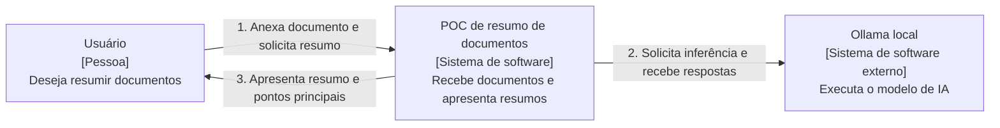
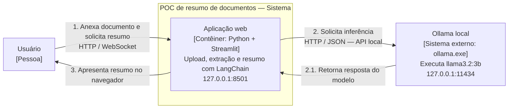
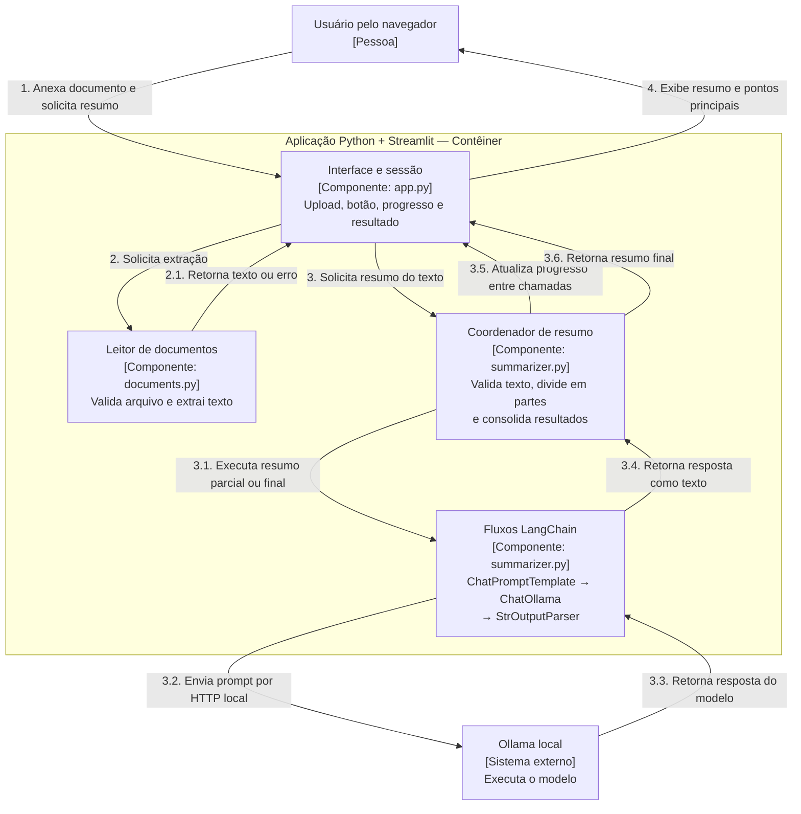
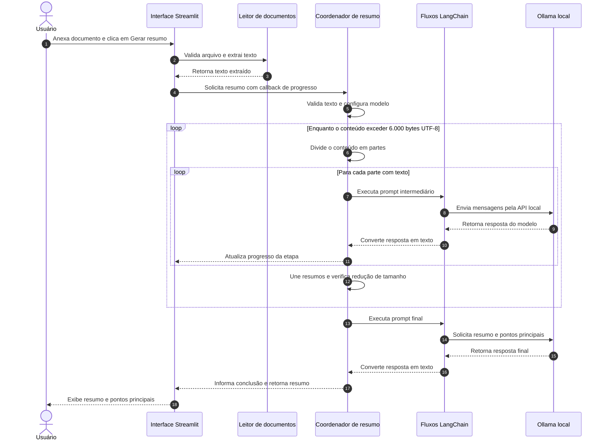

# Arquitetura — resumo de documentos

## Objetivo e escopo

A aba **Resumo** da POC recebe um documento TXT, PDF textual ou DOCX e gera um resumo com os pontos principais. Este documento descreve apenas esse fluxo: extração de texto, prompts e composição com LangChain, usando Ollama local. A avaliação de currículos está documentada em [arquitetura-rag.md](arquitetura-rag.md).

Instalação, execução e critérios de aceite estão no [README](../README.md). Os desenhos representam o fluxo de resumo no código atual; não indicam se os serviços estão em execução.

## Como ler os diagramas

As três visões usam as abstrações do [C4 model](https://c4model.com/), desenhadas em Mermaid. Cada nível amplia o anterior: contexto do sistema, aplicações que o compõem e componentes internos.

- **Pessoa:** quem utiliza o sistema.
- **Sistema:** uma solução com uma responsabilidade própria.
- **Contêiner:** aplicação ou armazenamento; neste documento o termo não significa Docker.
- **Componente:** uma responsabilidade interna de uma aplicação, sem processo próprio.

A fronteira da POC abrange a aplicação que desenvolvemos. O Ollama é um sistema externo a essa fronteira, mas é executado no mesmo computador. LangChain é uma biblioteca dentro do processo Python; o modelo é carregado pelo runtime do Ollama.

As setas numeradas indicam a ordem do cenário principal em cada visão. A numeração recomeça em cada diagrama; números como **2.1** detalham uma interação da etapa **2**. Como C4 descreve a estrutura, as repetições e a ordem das chamadas são detalhadas na [visão de sequência](#sequência--geração-do-resumo), que complementa os três níveis.

## C4 nível 1 — Contexto

Mostra o usuário, a POC e a dependência que executa o modelo. Detalhes de protocolo e implementação aparecem nos próximos níveis.

## C4 nível 2 — Contêineres

A POC possui uma aplicação Python com Streamlit, que oferece a interface web e coordena o processamento. O Ollama executa em outro processo e expõe uma API local.

Navegador, aplicação Python e Ollama são usados no mesmo computador. A interface escuta em loopback, e a integração com Ollama utiliza o endereço fixo `http://127.0.0.1:11434`. Não há banco de dados ou serviço de inferência na nuvem no fluxo implementado.

## C4 nível 3 — Componentes

Amplia o contêiner Python. Os componentes de coordenação e fluxos LangChain são responsabilidades lógicas implementadas no mesmo módulo `summarizer.py`, não serviços separados.

No cenário de sucesso, as interações **3.1 a 3.5** se repetem para as partes e níveis de consolidação e também atendem à chamada final. O retorno **3.6** acontece depois de concluir o resumo. Se a extração retornar um erro em **2.1**, a interface o apresenta e não inicia a etapa **3**.

| Responsabilidade | Implementação |
| --- | --- |
| Interface, sessão e tratamento de erros | [`app.py`](../app.py): `main()` e `clear_result()` |
| Validação de arquivo e extração | [`documents.py`](../documents.py): `extract_text()`; leitura TXT UTF-8, `pypdf` e `python-docx` |
| Configuração do modelo e tradução de falhas | [`summarizer.py`](../summarizer.py): `summarize()` |
| Divisão preservando Unicode | `split_text()` |
| Resumos parciais, consolidação e saída final | `run_summary()`, `PART_PROMPT` e `PROMPT` |

## Sequência — Geração do resumo

Esta visão complementar mostra a ordem das mensagens no cenário de sucesso. A numeração automática é própria deste diagrama e deve ser lida de cima para baixo. Os blocos `loop` representam repetições: documentos curtos pulam os resumos parciais e seguem diretamente para a chamada final. Este é um diagrama de sequência, não o nível 4 do C4.

## Fluxo de processamento

1. O usuário seleciona um arquivo e clica em **Gerar resumo**. A seleção do arquivo, isoladamente, não executa o modelo.
2. A aplicação valida extensão e tamanho e extrai o texto em memória. Arquivos inválidos, vazios, protegidos ou sem texto extraível geram uma mensagem de erro.
3. O coordenador valida o texto e configura `ChatOllama` conforme o modelo e a quantidade de camadas de GPU definidos no ambiente.
4. Até 6.000 bytes de texto UTF-8, a aplicação executa diretamente o prompt final.
5. Acima desse tamanho, divide o conteúdo em partes de até 6.000 bytes, preferindo quebras de linha ou espaços e preservando caracteres Unicode. Partes contendo somente espaços em branco são ignoradas.
6. As partes são resumidas sequencialmente com o prompt intermediário, que solicita até 100 palavras. Os resultados são unidos. Se ainda excederem 6.000 bytes, o processo se repete sobre esses resumos, em níveis.
7. Cada nível precisa reduzir o tamanho do conteúdo; caso contrário, o processamento termina com erro. Respostas vazias também interrompem o fluxo.
8. Quando o conteúdo cabe em uma chamada, o prompt final solicita **Resumo** e até cinco **Pontos principais**. O progresso é atualizado por etapa e parte concluída.
9. O resultado fica em `st.session_state` e é exibido como Markdown. Trocar o documento limpa o resumo anterior.

O fluxo LCEL é `prompt | model | StrOutputParser()`: o template prepara as mensagens, `ChatOllama` faz a chamada e o parser converte a resposta em texto. O processamento em partes é coordenado pelo código Python da POC.

## Configuração e limites

| Item | Valor atual |
| --- | --- |
| Arquivo e texto extraído | Até 10 MB cada: 10.000.000 bytes; texto medido em UTF-8 |
| Conteúdo por chamada | Até 6.000 bytes, além do próprio prompt |
| Modelo padrão | `llama3.2:3b`, configurável por `OLLAMA_MODEL` |
| Execução padrão | CPU: `OLLAMA_NUM_GPU=0`; `-1` permite seleção automática em ambientes compatíveis |
| Contexto solicitado | 8.192 tokens por chamada |
| Saída máxima | 800 tokens por chamada |
| Temperatura | 0 |
| Timeout do cliente HTTP | 300 segundos; não é um limite de duração do documento inteiro |
| Permanência do modelo carregado | Cinco minutos de inatividade entre chamadas |

As variáveis de ambiente têm prioridade sobre o `.env` local opcional. O `.env` é ignorado pelo Git; [`.env.example`](../.env.example) contém a configuração de exemplo.

## Decisões técnicas

- **Streamlit:** permite estudar o fluxo com uma interface escrita em Python.
- **LangChain modular:** `langchain-core` e `langchain-ollama` oferecem templates, integração com o modelo e composição de etapas para este caso de uso.
- **Ollama local:** permite inferência sem chave OpenAI ou tarifa de API. A instalação das dependências e o download inicial do modelo precisam de internet.
- **CPU por padrão:** a validação nesta máquina encontrou incompatibilidade CUDA/driver na GTX 1060. A configuração permite continuar utilizando a POC sem alterar drivers.
- **Redução hierárquica:** permite aceitar documentos maiores que o contexto de uma única chamada, sem truncar silenciosamente o texto original. O limite de 10 MB pode resultar em milhares de chamadas locais e horas de processamento.
- **Modelo mantido entre partes:** evita recarregamento a cada chamada, com consumo de memória enquanto estiver carregado.
- **Processamento em memória:** a aplicação não grava os anexos no disco nem mantém histórico persistente. O resultado fica na sessão Streamlit.
- **Comunicação local:** endereço Ollama fixo em loopback e cliente com `trust_env=False`; tracing externo do LangChain desabilitado no fluxo de resumo.

## Falhas e restrições

O processamento é síncrono, sem fila de trabalhos, checkpoint ou retomada implementados. Se ocorrer uma falha durante as partes, a aplicação mostra o erro e uma nova tentativa recomeça o processamento. Mensagens específicas cobrem serviço indisponível, modelo ausente, timeout, falha de execução e configuração inválida.

PDFs somente como imagem não são suportados, pois não há OCR. PDFs mistos podem resultar em extração parcial. DOCX cobre parágrafos e tabelas do corpo, sem interpretar imagens, cabeçalhos e rodapés.

O modelo e a consolidação podem omitir detalhes ou produzir informações incorretas. As instruções do prompt orientam o comportamento, mas não garantem fidelidade absoluta nem proteção completa contra instruções maliciosas no documento. O usuário deve revisar o resultado.

## Validação e manutenção

Os [testes automatizados](../tests/) cobrem extração, limites, Unicode, processamento integral de texto de 10 MB com modelo simulado, redução em níveis, erros e interface. A inferência real exige validação manual com Ollama e modelo disponíveis; o roteiro está no README.

Atualize este documento no mesmo conjunto de alterações que modificar fronteiras, componentes, integrações, configuração ou estratégia de resumo. As três visões usam a mesma fronteira de sistema. Não há diagrama de nível 4, de código; os links às implementações permitem consultar esse detalhamento diretamente.

## Referências

- [C4 — contexto](https://c4model.com/diagrams/system-context)
- [C4 — contêineres](https://c4model.com/diagrams/container)
- [C4 — componentes](https://c4model.com/diagrams/component)
